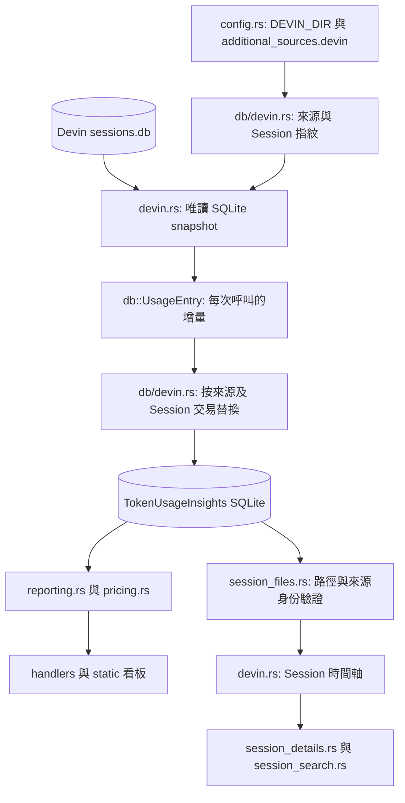

# Devin CLI 維護

先讀 `docs/fork-spec.md` 與 `.agents/skills/token-usage-insights/SKILL.md`。本 skill 說明 Devin adapter 的資料契約與修改順序；版本及發行流程以專案主 skill 為準。

## 計畫與完成條件

1. 核對目標 Devin CLI 版本與本機 SQLite schema。只檢查欄位、數值語意與模型識別，不輸出私人 prompt、憑證或原始會話資料。完成條件是確認每筆用量的來源、時間、模型與呼叫識別。
2. 在 `src/devin.rs` 修改唯讀解析，先用合成 SQLite fixture 證明 Token、快照去重及模型切換正確，再調整 `src/db/devin.rs` 的交易同步。完成條件是重複同步不增加用量，讀取失敗保留已匯入資料。
3. 逐一核對來源設定、CLI、API、詳情、全文搜尋與前端入口。變更範圍見下表。完成條件是兩個來源使用相同 Session ID 時，報表與詳情仍分開。
4. 更新有官方費率依據的模型、CHANGELOG 與 canonical spec，執行驗證。只有使用者要求發行時才升版、提交、推送與建立 Release。

Devin parser 是獨立 adapter；整合會修改共用同步與來源識別，整體按 Core 變更審查。特別檢查資料替換範圍、路徑驗證與計價。

## 架構

| 修改內容 | 主要位置 |
|---|---|
| SQLite 解析、模型與思考強度、時間軸 | `src/devin.rs` |
| 增量指紋、來源隔離、交易寫入 | `src/db/devin.rs`、`src/db.rs` |
| 根目錄與額外來源 | `src/db.rs`、`src/config.rs` |
| assistant 名稱與設定 API | `src/cli.rs`、`src/handlers/mod.rs`、`src/handlers/daily.rs` |
| 詳情安全邊界與全文搜尋 | `src/session_files.rs`、`src/session_details.rs`、`src/session_search.rs` |
| 模型費率與比對 | `pricing.csv`、`src/pricing.rs` |
| 選擇器、指南與翻譯 | `static/app.js`、`static/index.html`、`static/i18n.js` |
| 服務環境變數保留 | `scripts/install.sh`、`tests/install-systemd.test.sh` |

## 資料契約

- 預設來源為 `~/.local/share/devin/cli/sessions.db`。`DEVIN_DIR` 指定包含 `sessions.db` 的根目錄；`XDG_DATA_HOME` 影響預設資料目錄。額外根目錄使用 `additional_sources.devin`。
- `sessions` 提供會話 ID、標題與工作目錄；`message_nodes.chat_message` 保存 JSON 訊息。每次呼叫的用量取自 assistant 訊息的 `metadata.metrics`，模型取自 `metadata.generation_model`。
- Devin 的 `input_tokens` 不含 `cache_read_tokens`。總 Token 為輸入、輸出、快取讀取及快取建立之和；`context_input_tokens` 是當下上下文，不是額外用量。
- 同一個 request／message 可能有多個保存快照。以呼叫身份去重，保留完整用量；只有文字、沒有用量的 assistant 訊息不產生計費紀錄。Session 目前模型不能用來推測缺失的歷史模型。
- `metadata.created_at` 的 RFC3339 時間優先；SQLite `message_nodes.created_at` 為 Unix 秒。寫入前統一為 UTC。時間軸與用量使用相同的穩定回合識別。
- 來源身份包含 `assistant_type=devin`、`source_kind=devin-cli`、正規化根目錄的 `source_dir_key` 與 Session ID。同步只替換該來源、該 Session 的原生紀錄，保留手動匯入及其他來源。
- 使用唯讀 SQLite 交易取得一致快照。資料庫或查詢損毀時保留目的端資料；來源暫時離線或會話已刪除時也保留歷史。主 DB 與 WAL 的變更都要讓增量指紋失效。
- 詳情與搜尋只可讀取已設定根目錄內、來源身份相符的 `sessions.db`。驗證 canonical 路徑，拒絕指向其他檔案的符號連結。
- 匯入不需要執行 Devin、不呼叫雲端 API、不讀帳戶或憑證。ATIF export 可能只涵蓋部分會話，不與 SQLite 用量合計。

## 模型與計價

用 `devin models list --format json` 核對官方 CLI 當下公布的模型與費率。只讀取模型清單，無需啟動推論。參考 [官方模型文件](https://docs.devin.ai/cli/models)。

將 `medium`、`high`、`max` 等思考強度保存於 `reasoning_effort`；保留會改變費率的 `fast`、`lightning`、`priority` 後綴。Devin 的連字號版本名稱要能比對既有牌價，例如 `glm-5-3-max` 對應 `glm-5.3`。

只新增有數值依據的 USD 牌價。模型清單僅標示 `Free` 時，不能推論所有方案與歷史呼叫都為零元；未定價的 SWE 型號也不能回退到其他版本或 Lightning 費率。ACU、訂閱額度與估算 API 費用分開處理。隨附牌價是目前估算，不代表歷史帳單。

## 驗證

先執行 `mise exec -- cargo test devin --locked` 與 `mise exec -- cargo test --test additional_sources --locked`，涵蓋正常用量、重複快照、模型切換、損毀資料保留、多來源同 ID、詳情與全文搜尋。

整合完成後依主 skill 跑完整 Rust 測試、零警告 Clippy、npm 測試與發行建置。安裝腳本有修改時加跑 `bash tests/install-systemd.test.sh`。前端使用隔離資料與 loopback server，檢查 Devin 切換、設定指南、Session 詳情及總覽，截圖只使用合成資料。

驗收必須同時證明重複同步不增加用量、不同來源不混用，以及錯誤路徑無法讀取其他檔案。依實際執行結果回報，未執行的檢查列為未驗證。
