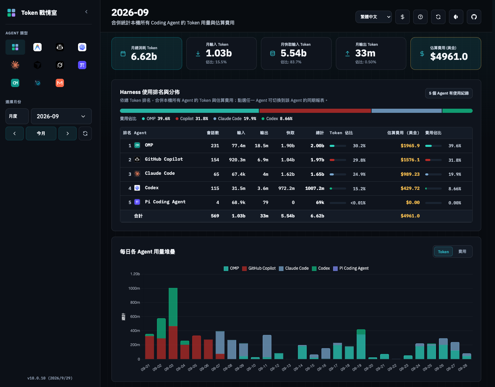
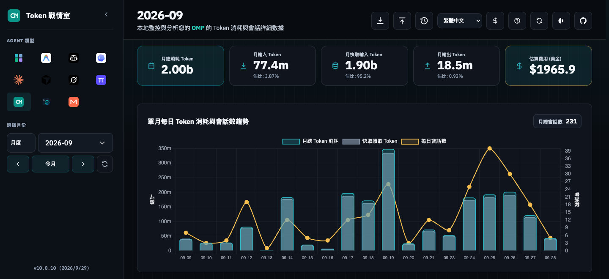
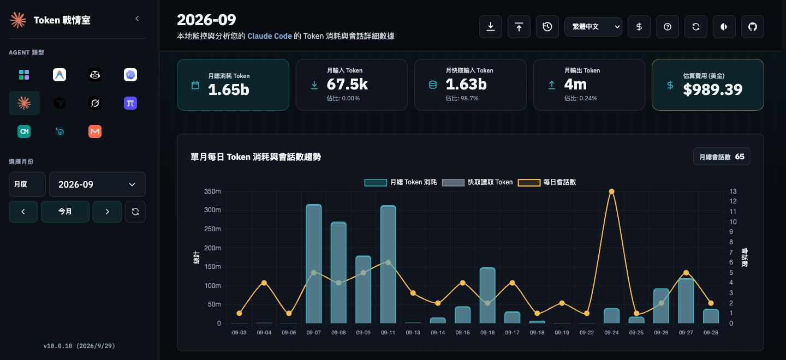

# Token 戰情室

Token 戰情室是本機優先的 AI Coding Agent 用量看板。它會將本機記錄匯入 SQLite，顯示 Token、估算費用與 Session 時間軸。

支援 Antigravity、Copilot、Codex、Claude Code、Cursor、Grok Build、Pi、OMP、Muse Code 與 MiniMax Code；所有來源均維持本機讀取。

本 repo 是 `fun-ed` fork，功能以 [docs/fork-spec.md](docs/fork-spec.md) 為準，不以 upstream 為準。只支援 macOS 與 Linux，沒有 CI/CD，發行一律手動。英文 [README](README.md) 是正式說明。

Claude Code 會讀取 `~/.claude` 與每個含 `projects/` 的 `~/.claude-profiles/<name>/`，Web UI 以 `Default`、`work`、`p2` 等 badge 標示來源。要背景自動匯入，請用 release 內的 `scripts/install.sh --service` 安裝服務。Claude Code 預設 30 天刪除 transcript，請在各 profile 的 `settings.json` 設定 `"cleanupPeriodDays": 365`。

OMP 同時讀取 `~/.omp/agent/sessions` 與 `~/.omp/profiles/<name>/agent/sessions`，保留各 profile 的獨立來源。設定 `OMP_DIR` 時停用自動 profile 探索。

Antigravity CLI 不需設定 Status Line 或收集腳本：看板直接讀取 `~/.gemini/antigravity-cli/brain/` 的原生會話記錄，並唯讀查詢 `conversations/<session-id>.db` 取得每次回應的模型。舊版 `usage/` 收集檔仍可匯入，同一會話不會重複計算。費用為依 `pricing.csv` 的估算；模型或價格不明時無法估算，不代表免費。

目前版本為 [v10.0.25](https://github.com/fun-ed/TokenUsageInsights/releases/tag/v10.0.25)。選用整合頁可唯讀顯示 Magpie、CodeBurn 與使用者選取的 ccusage daily JSON；三者都不匯入、不去重，也不與既有報表或彼此相加。Magpie 未定價用量不會顯示為 US$0；CodeBurn 只支援 `daily-cache.v74.json`，並標示來源時區與 cache metadata；ccusage 不會自動執行，只有使用者選擇 JSON 匯出後才在目前頁面解析。完整限制見[選用整合說明](docs/optional-integrations.md)。

v10.0.24 選擇性同步 upstream v1.5.1 的 GPT-6.1 Terra 定價。Global 每百萬 Token 輸入／快取讀取／輸出在 272K 以下為 US$1.00／0.05／5.00，超過為 US$2.00／0.10／7.50；Cursor 使用 US$1.00／0.05／5.00。費用為估算，既有優惠期限及限制見[官方費率查核](docs/research/2026-10-21-prompt-cache-pricing.md)。完整 macOS 安裝指令見英文 README。

要集中分析多個 `CODEX_HOME` 或雲端硬碟同步的其他電腦紀錄，可在 `config.yaml` 加入 `additional_sources`（例如 `codex: ['~/Cloud Drive/laptop/.codex']`）。額外目錄會追加在預設來源與 profile 之後，啟動、背景同步與「立即同步」都會重新讀取設定；額外的 Claude Code 與 OMP 目錄各自成為獨立來源。完整說明見英文 [README](README.md#additional-sources-multiple-homes-and-computers)。

側欄 **總覽** 合併所有 Agent、Claude 與 OMP profile，依總 Token 排名 Harness，顯示 Token 與費用佔比，並依 Agent 堆疊每日用量：



OMP 與 Claude Code 的單一 Agent 月報：





```bash
git clone https://github.com/fun-ed/TokenUsageInsights.git
cd TokenUsageInsights
cargo run --release
```

在瀏覽器開啟 <http://localhost:3003>。

要只建置並安裝本機 CLI，執行 `make install-local`。完整看板資源與背景服務請使用 release 的安裝腳本；本次發行提供 Apple Silicon 與 Intel macOS 套件，不包含 Linux 二進位或 npm Registry 發布。
