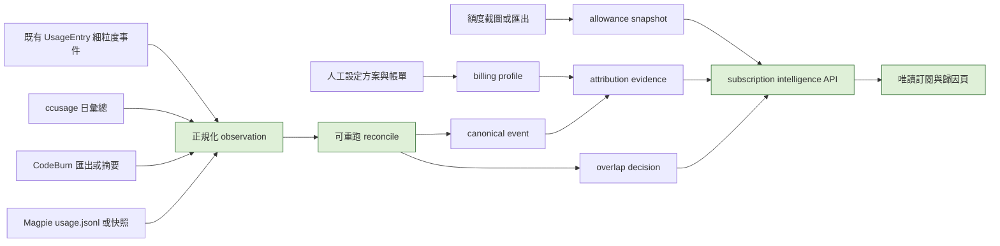

# TokenUsageInsights：訂閱、額度與使用歸因設計

狀態：draft；設計與唯讀原型已完成，所有實作 phase 均為 pending。資料截至 2026-10-29，時區為 Asia/Taipei。

## 目標

在既有的「總覽／日／月／年」TokenUsageInsights 看板旁新增一個唯讀的「訂閱與歸因」頁面。它回答四個不同問題：

1. 本月實際支付多少訂閱費用？
2. 已觀察到的使用量，以公開 API 價格換算約值多少？
3. 訂閱額度還剩多少、何時重置？
4. 哪一筆使用量可以由哪些證據歸因到訂閱、API 帳單或未知支付來源？

這些問題不可共用一個總額。模型名稱、路由名稱、Agent 名稱、畫面上的帳號標籤，都不是付款來源的充分證據。

## 已核對的現況

現有月報保持原樣：`static/app.js` 的 `loadMonthlyData()` 讀取 `/api/:assistant/monthly/:month`；`src/handlers/monthly.rs` 以 `db::get_usage_entries_by_month()` 和 `reporting::build_period_report()` 建立報表。SQLite 的 `UsageEntry` 已保留 `assistant_type`、`source_kind`、`source_dir_key`、session、時間、模型、Token 與成本欄位，因此可以成為細粒度觀測的第一來源。

| 來源 | 期間／範圍 | 可用觀測 | 本設計的用途 |
| --- | --- | --- | --- |
| TokenUsageInsights | 2026-10-01 至 10-28 | 約 US$2,775、10.89B Token、1,629 sessions | 月報的詳細事件基準，為 API 等效價值的一個觀測面 |
| CodeBurn | 10 月統計，含歷史保留 | US$2,335.60、58,117 calls、至少 767 sessions、97.7% cache；其中 US$45.09 是過期 session logs | 獨立摘要與覆蓋範圍證據，初期不能與 TokenUsage 相加 |
| ccusage 匯出 | 2026-10-01 至 10-29；29 日為部分資料 | 29 個日期的 `All` 列合計 US$1,282.25 | 原始日報校驗；子列不可再次加總 |
| Magpie | 截圖選擇 rolling 30 days，不等於自然月 | 約 US$685、18,115 gateway calls、6.1M 非快取 Token、2.16B cache read | 路由／額度輔助觀測；不是十月總額，也不能與月報相加 |
| 方案與額度截圖 | 擷取瞬間 | Claude 5 小時 79%、7 天 66%、Fable 88%；Codex 7 天 73% | 有時間戳的 allowance snapshot；不是 Token 或費用事件 |

使用者宣告 Claude Max US$200 與 ChatGPT Pro US$200 的每月方案承諾，合計 US$400。這不是已驗證的當月帳單扣款，因此畫面以「已宣告訂閱承諾」顯示，實際 charge 在有帳單證據前為 unknown。Magpie 截圖把 Codex 顯示為 `Prolite`，和已宣告的 ChatGPT Pro 不一致；系統必須保留此衝突，直到以帳單或明確 credential binding 釐清，不能自動把兩者綁定。

## 頁面與互動設計

新增側欄項目「訂閱與歸因」，僅在月檢視可用，預設選取目前月。既有 Overview、月報、日報、年報和所有既有 API 完全不改語意。

頁面先顯示四張彼此有明確標籤的卡片：

| 卡片 | 顯示內容 | 禁止的行為 |
| --- | --- | --- |
| 已宣告訂閱承諾／實際 charge | 使用者設定的週期承諾，以及有帳單證據才顯示的實際扣款 | 不將宣告承諾標成發票，也不從 API 等效費用推導金額 |
| API 等效價值 | 依來源分列的估算，顯示資料期間與覆蓋範圍 | 不把不同來源的估算相加 |
| 額度快照 | 剩餘比例、擷取時間、重置時間和資料新鮮度 | 不把「剩餘 73%」換成美元或 Token |
| 可驗證歸因 | 已綁定、待確認、衝突的估計值與事件數 | 不以模型或路由名稱直接認定付款來源 |

接著依序顯示：

1. **資料覆蓋與可靠度**：每個來源的觀測期間、粒度、是否含失敗／重試／失效檔案、是否為自然月。Magpie 固定標示「Gateway calls only；rolling 30 days」。
2. **歸因矩陣**：列是 Agent（Claude Code、OMP、Codex、Magpie），欄是觀測到的模型、路由、credential binding、billing profile、證據等級。`Anthropic`、`OpenAI` 等畫面標籤顯示為「觀測到的 client label」，非驗證過的 provider。
3. **去重決策清單**：每個 canonical event 或 aggregate 顯示 primary observation、佐證觀測、判定（exact duplicate、possible overlap、distinct、summary-only）與原因。使用者能打開來源紀錄檢查，不需相信隱藏演算法。
4. **Allowance 歷史**：將快照畫成階梯圖，不與 Token 趨勢併圖；不同窗口各自一條線。

介面要有三種明顯的資料狀態：`已驗證`、`待確認`、`衝突`。任何計算無法證明付款來源時顯示待確認，而不是分攤到 Claude Max 或 ChatGPT Pro。

## 資料流程



`UsageEntry` 不改成付款資料表。它仍表示本機解析到的使用紀錄。新資料表保存輸入來源、歸因證據與重算結果，讓同步重跑、價格規則更新或修正 binding 時可以重建結果。

## 建議資料模型

| 表／物件 | 核心欄位 | 用途 |
| --- | --- | --- |
| `usage_source_snapshots` | `id`, `source_kind`, `captured_at`, `period_start`, `period_end`, `granularity`, `content_sha256`, `coverage_note`, `retention_state` | 不可變的匯入批次；只存本機路徑與雜湊，不存帳號明文 |
| `usage_observations` | `id`, `snapshot_id`, `native_id_namespace`, `native_id`, `machine_ref`, `account_ref`, `request_id`, `occurred_at`, `assistant`, `client_label`, `route_label`, `model`, `tokens_*`, `reported_estimate_usd_micros`, `currency`, `pricing_version`, `outcome`, `raw_ref` | 各工具觀察到的原始使用；native ID 必須綁定來源、機器與帳戶 namespace，`client_label` 與 `route_label` 不等於 provider 或 billing source |
| `canonical_usage_events` | `id`, `occurred_at`, `event_fingerprint`, `primary_observation_id`, `resolution` | 只有能以事件粒度確認的資料才進入可加總事件集 |
| `observation_links` | `observation_id`, `canonical_event_id`, `relationship`, `confidence`, `reason` | 保存 `primary`、`exact_duplicate`、`possible_overlap`、`corroborates_summary`，不可靜默丟棄資料 |
| `billing_profiles` | `id`, `provider`, `plan_label`, `cycle_start`, `cycle_end`, `amount_usd`, `billing_evidence`, `status` | Claude Max 和 ChatGPT Pro 的實際支付資料；帳單證據與方案宣告分離 |
| `attribution_evidence` | `canonical_event_id`, `billing_profile_id`, `evidence_type`, `confidence`, `valid_from`, `valid_to`, `note` | 將使用事件綁到付款方案；只接受可檢查的證據 |
| `allowance_snapshots` | `id`, `billing_profile_id?`, `observed_account_ref`, `window_kind`, `limit_label`, `remaining_pct`, `observed_at`, `resets_at`, `source_snapshot_id` | 額度是獨立時間序列；`billing_profile_id` 可為空以保留未解決衝突 |

帳號欄位使用本機 salted reference 或使用者設定的別名。原始 email、access token、session cookie 與完整 log 不應出現在 API response、畫面、匯出或測試 fixture。

Token 欄位必須明確表達語意：`input_uncached`、`cache_read`、`cache_write` 與 `output` 互斥；若來源只提供 inclusive input，另存 `input_inclusive` 而不臆測拆分。`reasoning` 是 output 的子集，只可顯示，不能再加進 `output` 或 `total`。費用一律以 ISO 4217 currency 加整數 micro-unit 儲存，並保存 `pricing_version`、rate unit（每百萬 token 或來源原生單位）和計價時間，避免將不同價格表的估算當成同一數字。

## 歸因與去重規則

### 付款歸因

1. `direct credential`：來源記錄提供不可逆 credential reference，且設定將該 reference 綁到有效 `billing_profile`。可標為已驗證。
2. `billing statement`：使用者以帳單或付款紀錄確認所屬方案。可標為已驗證，但僅適用其有效期間。
3. `manual verified mapping`：使用者確認某個 profile／route 的付款來源；顯示手動驗證。
4. 模型名稱、`Anthropic`／`OpenAI` client label、Gateway route、Agent 名稱或同一畫面帳號字串，僅能產生待確認候選，不能建立 binding。
5. 有相互矛盾的方案標籤時，建立 `conflict` evidence，該事件和 allowance snapshot 不列入任何訂閱的已歸因總數。

### 去重

1. 同一來源的完全相同 `native_key` 或 `content_sha256 + native_key` 重匯，標為 `exact_duplicate`，不建立第二個 canonical event。這保證同步具冪等性。
2. 不同來源只有在共享 request ID，或同一 session identity、同一 turn、同一時間、同一模型和所有 Token 分量均可驗證相符時，才可自動合併。保留兩個 observations 及合併理由。
3. 只靠相近時間、相同模型、總額接近或相同帳號標籤，建立 `possible_overlap`，但兩筆不進行自動相減或強制合併，也不得進入跨來源 combined total；頁面顯示它們是未定重疊的 coverage candidates。
4. ccusage 與 CodeBurn 的日／月摘要在取得逐事件資料前維持 `summary-only`。它們用於覆蓋與差異提示，不加入 canonical total。
5. CodeBurn 的保留但已過期 session logs 必須保留 `retention_state=expired_detail_missing`。它可出現在來源摘要，不能覆蓋仍存在的詳細事件，亦不能用來刪除事件。
6. 所有 reconciliation 以來源 snapshot 的 revision 為輸入；重跑時只撤銷該 revision 擁有的 link/projection，再在單一交易中建立新 links。canonical event 有其他 snapshot 的 reference 時不得刪除，採 reference check 或 copy-on-write。原始 observations 永不刪除。

這個規則避免把「不同工具看見同一流量」錯當成「可精確抵銷」，也避免遺失無法再解析的歷史摘要。

## API 契約

新增 `GET /api/subscription-intelligence/:year_month`。它只讀取衍生資料，不寫入來源紀錄，回傳：

```json
{
  "period": "2026-10",
  "subscription_commitments": [{"billing_profile": "claude-max", "amount_usd_micros": 200000000, "currency": "USD", "status": "declared"}, {"billing_profile": "chatgpt-pro", "amount_usd_micros": 200000000, "currency": "USD", "status": "declared"}],
  "actual_charges": [{"billing_profile": "claude-max", "amount_usd_micros": null, "currency": "USD", "status": "unknown"}, {"billing_profile": "chatgpt-pro", "amount_usd_micros": null, "currency": "USD", "status": "unknown"}],
  "api_equivalent_views": [{"source": "token-usage", "amount_usd": 2775, "coverage": "2026-10-01..2026-10-28", "additive": false}],
  "attribution": {"verified_usd_micros": null, "pending_usd_micros": null, "conflicted_usd_micros": null, "status": "not_yet_reconciled"},
  "allowances": [],
  "coverage": [],
  "deduplication": {"canonical_event_count": 0, "exact_duplicates": 0, "possible_overlaps": 0}
}
```

`api_equivalent_views` 是一組平行觀測，沒有 `total` 欄位。前端只能在同一個 source、同一份粒度與已去重 canonical events 範圍內顯示合計；有 `possible_overlap` 的候選必須從跨來源合計排除並標記 coverage 不完整。

## 實作分期

### Phase 1：不改現有報表的資料基礎

狀態：pending。

- 可修改：`src/db.rs`（migration 與 transaction helper）、新 `src/subscription_intelligence.rs`、其 Rust tests。
- 建立 immutable snapshots、observations、billing profiles、allowance snapshots、link tables。
- 匯入僅支援 TokenUsage 現有 detailed rows 與手動的 subscription／allowance JSON fixture。
- 驗證：同一 snapshot 重匯只產生一筆 observation；兩個來源只有弱相似度時都保留；過期摘要不能覆蓋詳細事件。

### Phase 2：讀取 API 與歸因規則

狀態：pending。

- 可修改：新 `src/handlers/subscription.rs`、`src/handlers/mod.rs`、`src/main.rs`、新測試。
- `GET /api/subscription-intelligence/:year_month` 只讀；在 `spawn_blocking` 內查 SQLite。
- 驗證：沒有 billing binding 的 GPT／Claude observations 仍為 pending；Prolite/Pro 衝突回傳 conflict；實際支出與 API equivalent 不互相計算。

### Phase 3：頁面整合

狀態：pending。

- 可修改：`static/index.html`、`static/app.js`、`static/i18n.js`、`static/styles.css` 或現有 component CSS、前端測試。
- 新增獨立頁籤，保留 Overview 和月報的 DOM、資料載入與 URL 行為。使用現有 `formatCost`、表格、卡片和語系模式。
- 驗證：選取 2026-10 時四種卡片分開呈現；零筆資料呈現空狀態；API 的 `additive=false` 永遠不進入合計。

### Phase 4：來源連接器與可審計整理

狀態：pending。

- 可修改：新 adapter modules 與 CLI import command；不修改既有 parser 的刪除或替換語意。
- 先支援 Magpie `usage.jsonl` 的逐事件匯入；CodeBurn 與 ccusage 在有穩定 event ID 前維持摘要匯入。
- 每份來源顯示時間範圍、缺失明細、失敗／重試和是否是 rolling window。
- 驗證：Magpie 的 reasoning 只顯示為 output 的子集，總 Token 不會再加一次；gateway totals 與 session-log totals 不混合。

### Phase 5：人工核對與回歸

狀態：pending。

- 以本月資料建立 anonymized fixture，逐一比對 TokenUsage、ccusage、CodeBurn、Magpie 的來源卡。
- 驗證：既有 `make test`、新 Rust tests、前端 utilities tests，以及手動檢查本機看板的月報與新頁籤。
- 產出資料差異報告，不宣稱多來源總計是真實帳單。

## 開發保護

- 不改動既有 `UsageEntry` parser、Claude transcript 保留、session replacement 或同步游標語意。新 reconciliation 層只讀其已匯入資料。
- 不把完整來源資料、帳號或 session logs 納入 repository、screenshot 或 API。
- 不新增外部服務或前端 framework；使用既有 Rust/Axum/SQLite/plain ES modules 結構。
- API equivalent 的牌價仍是估算。它不應被顯示成供應商發票、訂閱節省、或付款金額。
- Rollback：移除新增頁籤與 API route 即回到現有 Dashboard；資料 migration 保留但不讀取。若需要移除新表，先備份 SQLite 檔案並以對應 migration 的反向步驟在副本驗證，絕不觸及既有 `usage_entries`。
